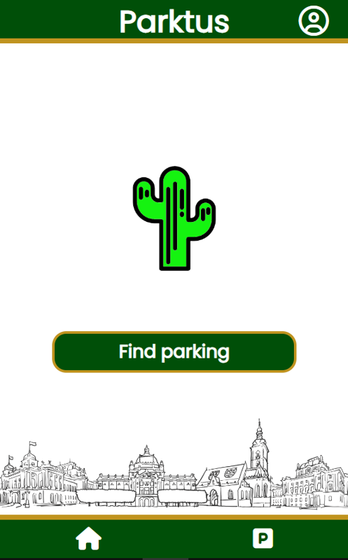
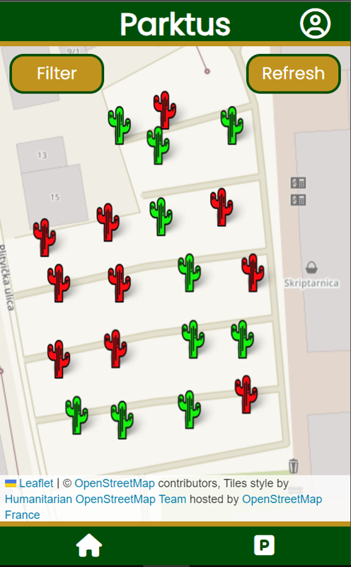
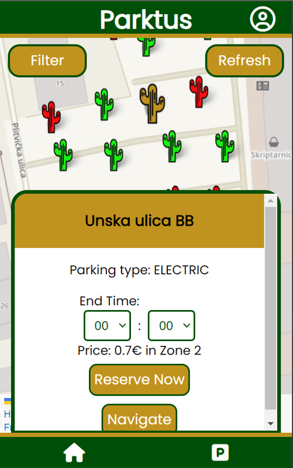
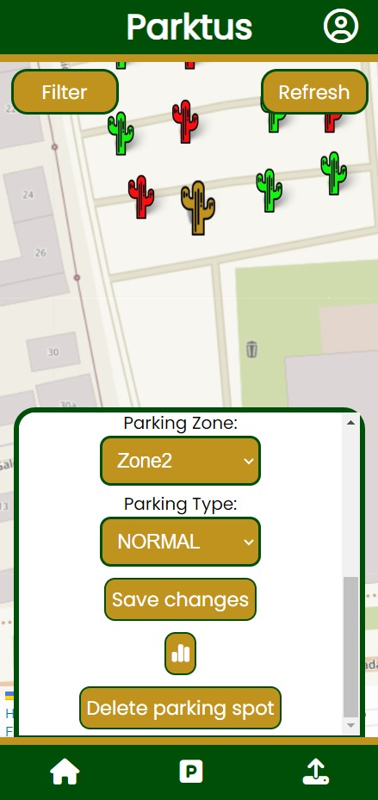

# Parktus

A web app for finding, reserving and navigating to free parking spots in Zagreb. Built by team
**Kaktusi** in 24 hours at the **KojiKukac Hackathon** (November 2023).

<p align="center">
  
  
  
  
</p>

## The problem

Parking near Zagreb's city center is scarce and expensive, and drivers lose around ten minutes looking
for a spot. Parktus shows which spots are free right now, lets you reserve one and guides you there.

## Features

- **Live map** of parking spots (Leaflet + OpenStreetMap): green cactus = free, red = occupied
- **Spot details**: parking type (regular, disabled, electric), zone and hourly price
- **Reservations** until a chosen time, plus an in-app wallet with a top-up balance
- **Navigation** to the selected spot with turn-by-turn routing
- **Filters** by parking type and location
- **Occupancy analytics** per spot, based on a log of occupancy changes
- **Accounts** with registration and login; **admin** role for adding, editing and deleting spots

During the hackathon, spot occupancy came in live from sensor events that the organizers streamed through
Azure Event Hubs.

## Tech stack

| Layer | Technologies |
|---|---|
| Backend | Java 17, Spring Boot 3, Spring Data JPA, REST API |
| Database | PostgreSQL |
| Frontend | Svelte, Vite, Axios, Leaflet (+ routing machine and marker clustering) |
| Data | Azure Event Hubs (live sensor events at the hackathon) |

## Running locally

**Backend** (needs a PostgreSQL database called `kaktusi`):

```bash
cd server
export DB_USERNAME=postgres DB_PASSWORD=your_password   # Windows: set DB_PASSWORD=...
./mvnw spring-boot:run          # starts on http://localhost:8080
```

`DB_URL` can also be set if the database is not on `localhost:5432`.

**Frontend:**

```bash
cd client
npm install
npm run dev                     # opens on http://localhost:3000
```

## Team

Four-person team *Kaktusi*. My part was setting up the PostgreSQL database and its connection to the
Spring Boot backend, and preparing and presenting the pitch
([slides](docs/PARKTUS-pitch.pptx), in Croatian).
